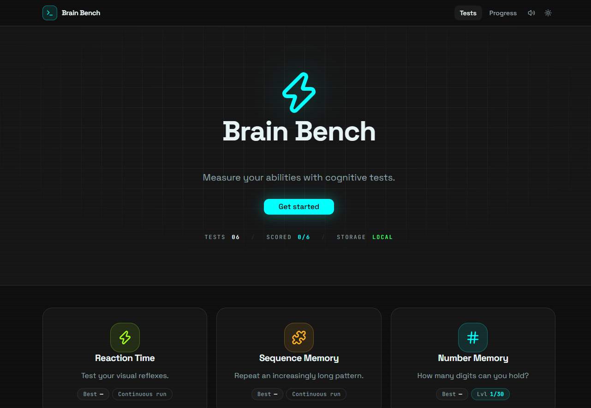
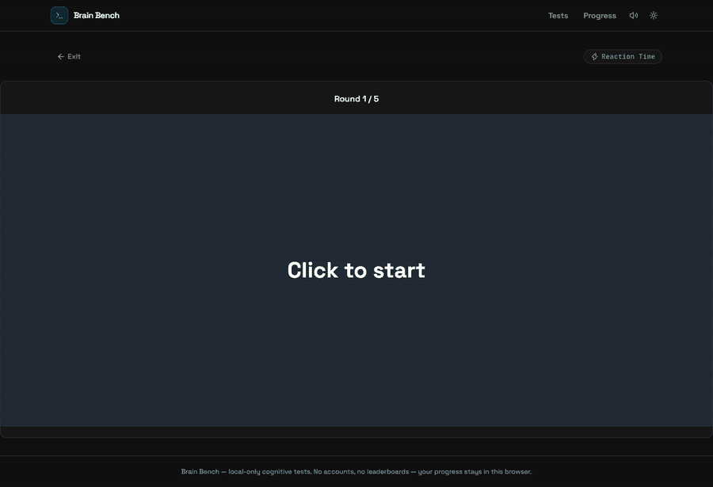
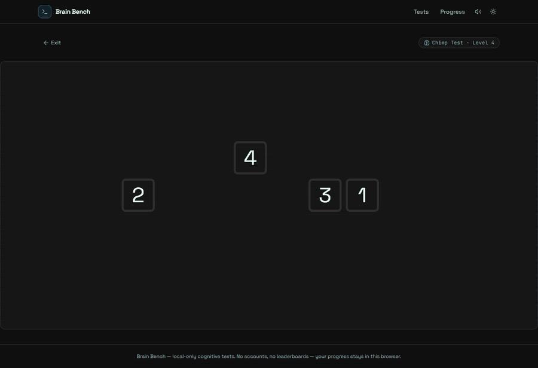
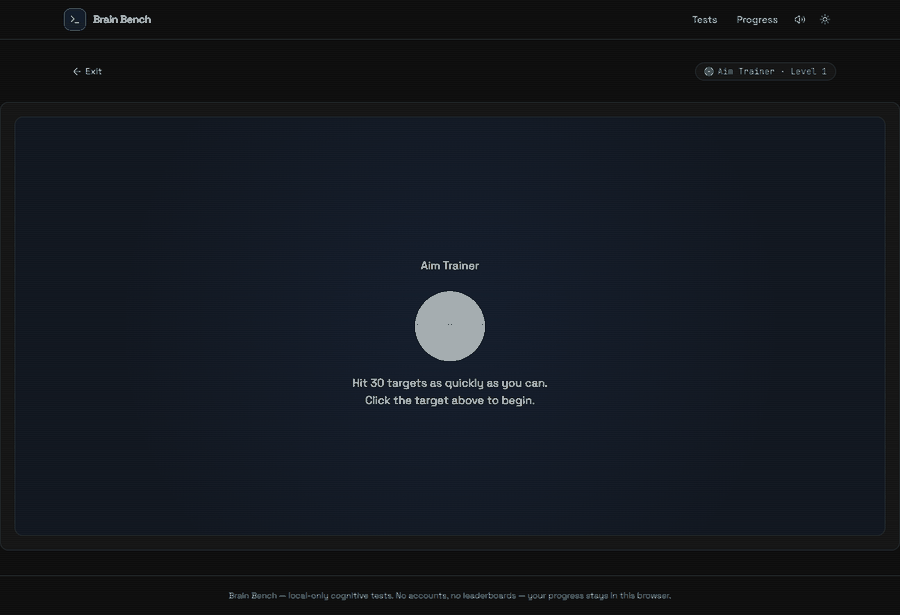
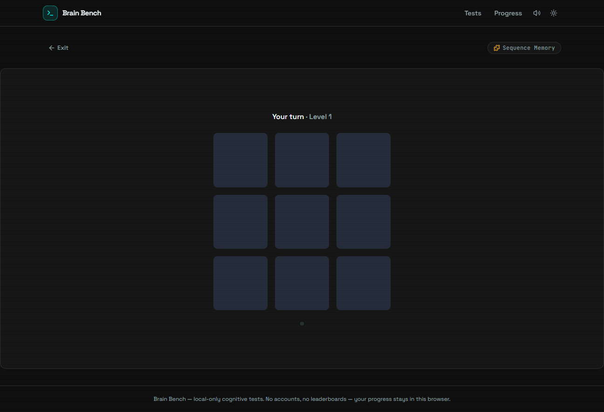
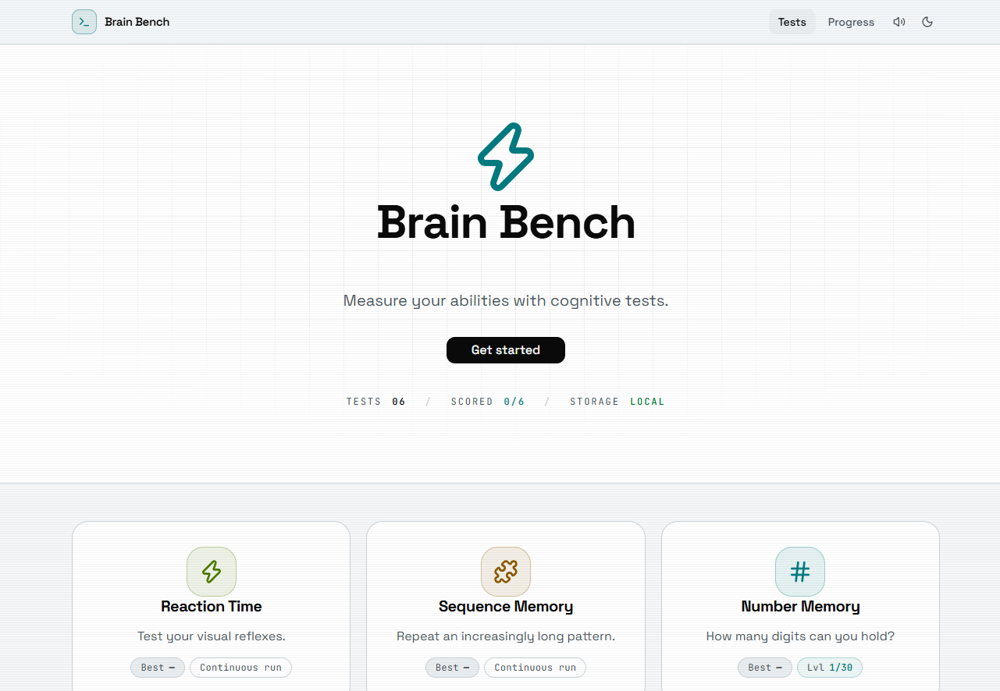

# Brain Bench

Brain Bench is a small site with six cognitive tests you can take in the browser. It's modeled closely on Human Benchmark — same tests, same scoring — but it runs entirely on your own machine. No accounts, no leaderboards, no server. Your results just stay in your browser.



## The tests

- **Reaction Time** — click the instant the box turns green.
- **Sequence Memory** — watch the tiles flash and repeat the pattern. It adds one every round.
- **Number Memory** — a number flashes on screen, then hides. Type back as much as you caught.
- **Visual Memory** — some tiles light up on the grid. Find them again before you lose all three lives.
- **Chimp Test** — click the numbers in order. They hide after your first click, and three strikes end the run.
- **Aim Trainer** — thirty targets, one at a time. Your score is your average time per target.









## Your progress

The bigger tests work in levels: pass one and the next unlocks, and your best scores carry over between visits. Everything is saved in localStorage on your own machine. The Progress page has export and import buttons if you want to back your results up as a JSON file or move them to another computer.

## The look and the sounds

It's a cyberpunk neon theme — dark by default, with a light mode if you'd rather not stare into the void. Each test has its own accent color, and there's a small audio button in the header for silencing the blips. Text contrast is checked against WCAG AA in both themes, and the animations stand down automatically if your system asks for reduced motion.



## Running it

```bash
npm install
npm run dev
```

Open http://localhost:5173 and pick a test. `npm run build` type-checks everything and writes a production bundle to `dist/`.

One thing worth knowing: it's React, TypeScript, and Vite on the front, with Tailwind and shadcn/ui for the interface. The interesting part is that each test's logic lives in `src/core/` as a plain TypeScript environment — no React, no timers, just ticks and a seeded random number generator. A run can be replayed exactly, which keeps the games testable and makes it easy to point a reinforcement-learning agent at them later.
